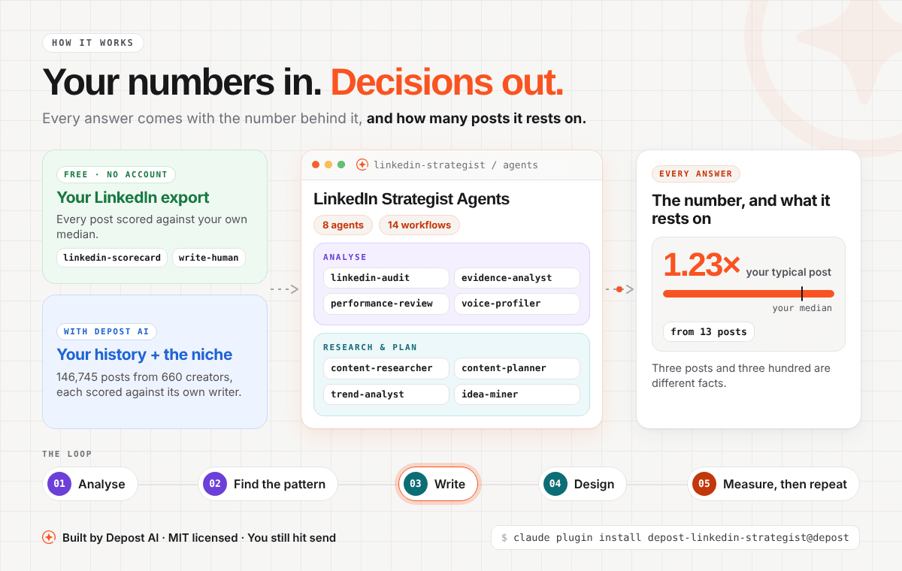
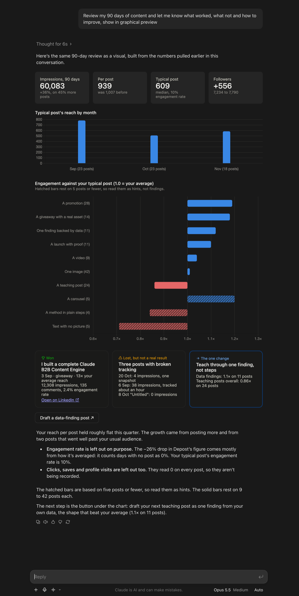
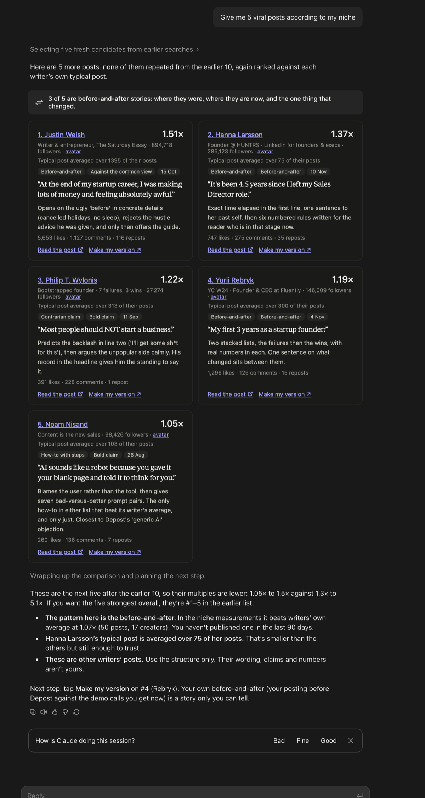
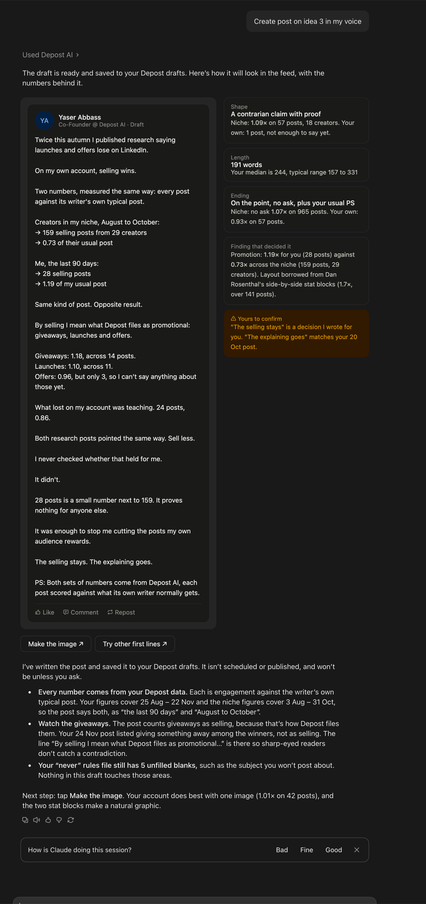
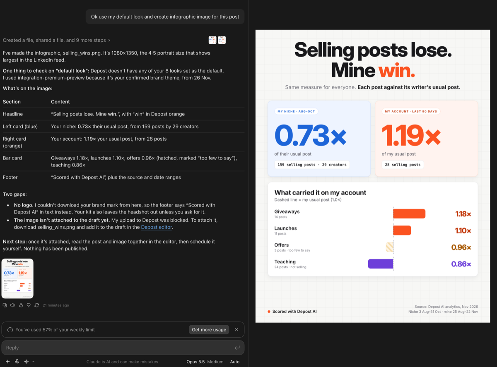

# LinkedIn Strategist Agents

<picture>
  <source media="(prefers-color-scheme: dark)" srcset="assets/agents-orbit-dark.gif">
  <source media="(prefers-color-scheme: light)" srcset="assets/how-it-works.gif">
  
</picture>

A content system that works from **your** LinkedIn numbers instead of general advice
about LinkedIn.

LinkedIn's own analytics tell you what a post got. They do not tell you which of your
post shapes beat your own average, which opener works for an account your size, or
which of your subjects you have already worn out.

**Two parts of this work with no account at all.** The rest connects to Depost AI.

## Start free, nothing to connect

| Workflow | What it does |
| --- | --- |
| `linkedin-scorecard` | Export your own analytics from LinkedIn, upload the file, and get every post scored against your own median — what beat your average, what cost you, and the pattern |
| `write-human` | Write or fix a post so it does not read as machine-written. The formatting tells, the structural tells, the vocabulary, and the one test that matters |

Install the plugin, ask for *my LinkedIn scorecard*, and follow the export steps it
gives you. No sign-up, no key, no card. Your file is read in the conversation and goes
nowhere else.

`write-human` ships the full standard — every tell, with the research behind it,
including the September 2026 test of what ChatGPT and Claude actually leave in a copied
draft. Read it, fork it, keep it.

## What a file cannot tell you

A spreadsheet of your own posts is one account with no memory either side of it. Three
questions stay open no matter how carefully you read it:

1. **Is the pattern real, or a coincidence?** Your best posts share something — but
   with nothing to compare against, there is no way to know whether that shape wins
   generally or those weeks just had better material.
2. **Which opening works at your size?** Openers can't be measured on one person's
   posts; there are never enough of any one kind. That answer only exists across many
   accounts.
3. **What did you already say, and how did it do?** A file has no memory of March.

The rest of this system answers those, against 146,745 high-performing posts from 660
creators — each scored against **its own writer's** typical post, which is what makes a
2,000-follower account and a 200,000-follower account comparable in the same table.

## Then: run the audit

> *Run my LinkedIn audit.*

One agent, four analyses, one written report: where the account stands, the three
shapes that measurably work, the format that is costing you, how you actually sound,
the gaps, and three things to do next — each with the number behind it. Including the
section most reports leave out: what could not be measured, and why.

## How people actually use it

The prompts are ordinary. What makes them worth running is that the answer comes back
with a number attached, and says how many of your posts that number rests on.

### Free, before you connect anything

> **"Here is my LinkedIn export. Score my posts."**
> Every post against your own median, your best three and worst three, the pattern
> across them, and the three things a file cannot tell you.

> **"Does this draft read as AI?"**
> Checked against the full standard: formatting that pastes in as literal characters,
> an opening that sets a scene instead of making a claim, a tidy lesson at the end.

### 1. See what your last 90 days actually did

> **"Review my 90 days and tell me what worked, what didn't, and how to improve."**



*Every bar is a shape scored against your own average, with its post count in brackets.
Bars resting on five posts or fewer are hatched and labelled hints, not findings. The
middle card is a loss it refused to call a result, because the tracking was broken.*

### 2. Find what is working in your niche

> **"Give me five viral posts in my niche."**



*Ranked by each post's multiple of **its own writer's** average, never by likes — so a
2,000-follower account and an 800,000-follower one are comparable. Every card says how
many of that writer's posts the average rests on, because 1.51× over 1,395 posts and
1.37× over 75 are different facts.*

### 3. Turn that into ideas you could credibly write

> **"Give me five ideas I have not covered, each with the number behind it."**


*Each idea names the figure it rests on and how many posts that figure has behind it.
An idea that cannot name one is labelled a hunch.*

### 4. Write it in your voice

> **"Create a post on idea 3, in my voice."**



*The panel carries the finding behind every choice. The amber box is the part most tools
leave out: the one line it wrote for you that you still have to confirm.*

### 5. Draw the graphic in your own look

> **"Use my default look and make the infographic for this post."**



*Drawn in your own confirmed look at 1080×1350 for the feed. The bar resting on three
posts is hatched and labelled "too few to say" rather than quietly shown as a finding.*

### And the ones it will argue with you about

> **"I think carousels work for me. Check that."**
> It will tell you if they do not. A shape resting on three posts does not overrule a
> measurement across hundreds, and it says so rather than agreeing with you.

> **"My reach dropped. Is it what I am writing, or something else?"**
> If impressions fell while your engagement rate held, that is a distribution story and
> not a content story. It says which one your data supports instead of inventing a
> content explanation.

> **"Have I already said this?"**
> Searched against everything you have published, with how each performed. Three strong
> matches that all underperformed means the subject was not the problem; the shape was.

## It reads like an answer, not a database

Every skill here follows one presentation standard, because analysis you have to decode
is analysis that failed:

- **The finding in the first line.** No preamble, no narrating which tools it is about
  to call.
- **No internal keys.** "a giveaway with a real asset", never `lead_magnet_giveaway`.
  "Not enough posts yet to say", never `not_enough`.
- **Every number carries what it rests on.** `1.23× your typical post, from 13 posts` —
  because three posts and three hundred are different facts, and a bare multiple hides
  which one you have.
- **Caveats sit beside the number**, not in a closing paragraph nobody reads.
- **One line on what it skipped**, and why.
- **One next step at the end**, not a menu of four.

Ask *show me that as a table* or *shorter* and it reshapes what it already has without
re-running anything, so the numbers cannot quietly change.

## The eight agents

Each takes a job, works on its own, and comes back with a result.

| Agent | What it does |
| --- | --- |
| `linkedin-audit` | The full audit. Performance, evidence, voice and gaps in one report |
| `evidence-analyst` | Which shapes, openers, formats and endings beat your own average, at your follower size and across your niche |
| `performance-review` | What a period actually did, which posts won and lost, the one change worth making |
| `voice-profiler` | How you actually write, derived from your published posts rather than described in adjectives |
| `content-researcher` | What you have already said on a subject, what you saved about it, how strong writers handled it |
| `content-planner` | A plan built from your backlog, your stated priorities and the gaps |
| `trend-analyst` | What is rising and fading in your niche, and which of it you could credibly write |
| `idea-miner` | Mines posts that worked for other writers for structures you could use, checked against your own history |

## The fourteen workflows

| Workflow | Needs an account? |
| --- | --- |
| `linkedin-scorecard` · your own export, scored against your median | **no** |
| `write-human` · write or fix so it does not read as generated | **no** |
| `what-works` · which patterns beat your own average, and your niche | yes |
| `performance-review` · what your last 7, 30 or 90 days did | yes |
| `voice-profile` · what your writing is recognisable for | yes |
| `research-subject` · have you covered this, and what angles are left | yes |
| `content-plan` · what to post, and when | yes |
| `write-post` · a draft in your voice, in a shape the numbers support | yes |
| `post-critique` · does this read as AI, and is the shape right for you | yes |
| `brand-visual` · an image in your own brand look | yes |
| `viral-search` · posts that worked, by format, hook type, industry or date | yes |
| `viral-trends` · what is rising and fading in your niche | yes |
| `viral-ideas` · other writers' structures as ideas only you could write | yes |
| `present-results` · show an answer again, clearer, shorter or as a table | either |

A fifteenth, `connect-depost`, handles setup.

Writing, critique and visuals are workflows and not agents on purpose: each needs you
partway through — a blank only you can fill, a draft you paste in, a picture you look
at — and a job that goes away and comes back is the wrong shape for that. Library
search stays a workflow because it is a lookup you want back immediately.

## Where each part loads

| | Claude chat | Cowork | Claude Code |
| --- | --- | --- | --- |
| The fourteen workflows | yes | yes | yes |
| The eight agents | no | yes | yes |

Nothing breaks in chat — the workflows cover the same ground, you just drive them in
the conversation instead of handing a job over.

## Install

**Claude (chat, desktop, mobile)**

1. **Customize → Plugins → Add → Add marketplace**, and paste this repository's URL.
2. Install **LinkedIn Strategist Agents**.
3. Ask: *my LinkedIn scorecard*.

**Claude Code**

```bash
claude plugin marketplace add remoteen/depost-linkedin-strategist
claude plugin install depost-linkedin-strategist@depost
```

## Get your key, when you want the rest

**1. Create a Depost account and connect LinkedIn.** [app.depost.ai/signup](https://app.depost.ai/signup).
Depost imports your post history and runs the first analysis — that history is what
every measurement is computed from.

**2. Create the key.** **[Settings → MCP](https://app.depost.ai/settings/mcp)**. It
starts `dp_mcp_`, and the page hands back a connection URL with the key in it.


*Name the key after the account or client that will hold it. Publishing is marked high
risk and stays off until you choose otherwise.*

**3. Tick the permissions you want.** A new key gets four by default, and they cover
almost everything:

| Permission | Default | What stops working without it |
| --- | --- | --- |
| Context, content and analytics read | **on** | Everything. This is the data |
| Drafts write | **on** | Saving drafts and ideas |
| Visual read | off | `brand-visual` — your brand kit and looks |
| Media write | off | Attaching a generated image to a draft |
| Publishing | **off** | Scheduling and publishing |
| Leads read | off | Reading your prospect lists |

**A key cannot publish anything unless you tick Publishing yourself.** It is off when
the key is made. Leave it off and the whole system still analyses, researches, plans,
writes and saves — it just cannot put anything on LinkedIn. That is the recommended
setup.

**4. Connect it.** In Claude: **Settings → Connectors → Add custom connector**, and
paste the connection URL.


*The same steps inside the product, with a tab per client. The connection URL is blurred
here for the obvious reason — it contains the key.*

In Claude Code:

```bash
claude mcp add --transport http depost "https://api.depost.ai/mcp" \
  --header "Authorization: Bearer YOUR_DEPOST_KEY"
```

Treat the key as a password. It does not go in a repository, a post, or a message to
anyone.

**The full walkthrough, with screenshots of every step:**
**[How to connect Claude to LinkedIn](https://depost.ai/blog/connect-claude-to-linkedin)**

## What it does not do

- **Claude never touches LinkedIn.** Depost holds the official LinkedIn connection.
- **Nothing publishes unless you ask for it in that conversation**, and the exact text
  is confirmed first.
- **No profile is scraped.** Ever, connected or not. The data is yours — your own
  export, or your own connection.
- **No invented numbers.** Every figure comes from your file or a live call, or it
  leaves a marked blank and asks you. Including the unflattering ones.
- **The free scorecard never claims to compare you to anyone else.** It cannot, and
  saying it could would make the whole thing worthless.

## Data

`linkedin-scorecard` and `write-human` send nothing anywhere. Your export is read in
the conversation.

The rest sends your prompts and the subjects you ask about to your own Depost AI
account through `api.depost.ai`, and reads back your brand profile, posts, performance,
saved material and the reference library. Drafts and ideas you ask to keep are stored
in your Depost account. The plugin itself stores nothing and contains no credentials.

## Links

- **[depost.ai](https://depost.ai)** — the product
- **[Connect Claude to LinkedIn](https://depost.ai/blog/connect-claude-to-linkedin)** — the setup guide, with screenshots
- **[Settings → MCP](https://app.depost.ai/settings/mcp)** — where your key lives
- **[Start free](https://app.depost.ai/signup)** — no card for the analysis
- **[Pricing](https://depost.ai/pricing)**
- **[Blog](https://depost.ai/blog)** — LinkedIn research and guides

## Licence

MIT. The instructions are yours to read, fork and change.
